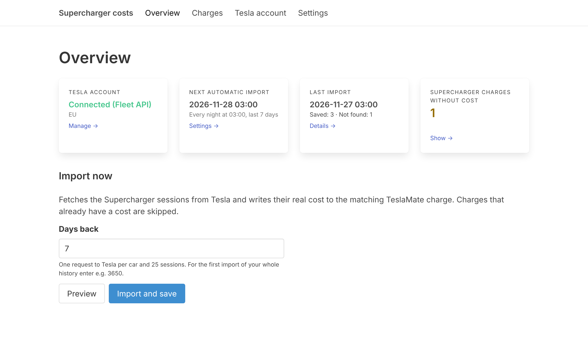
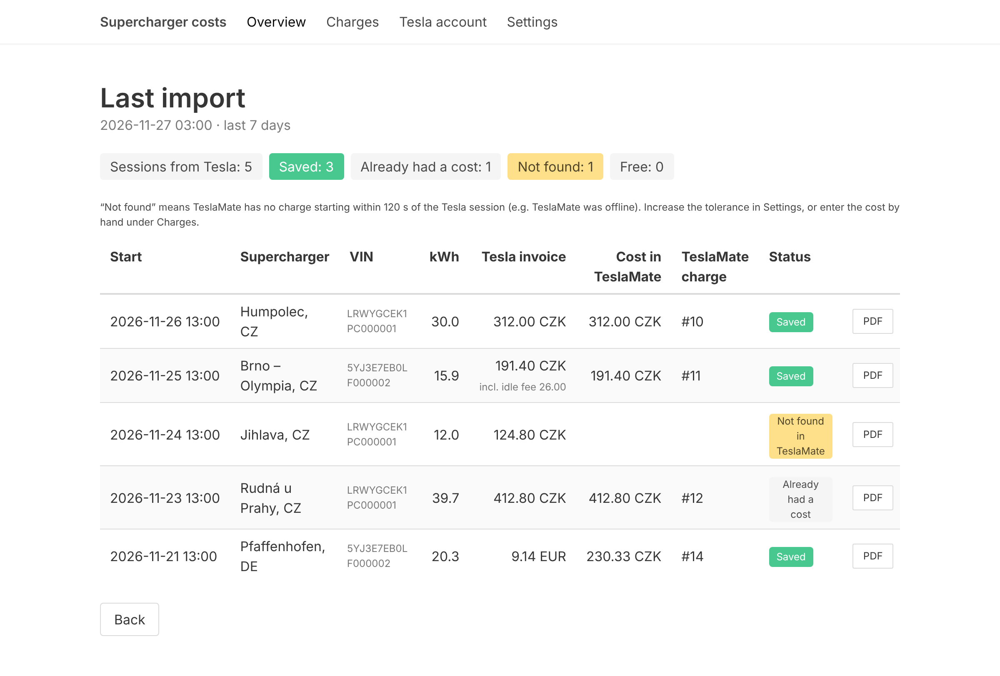

# TeslaMate Supercharger Cost Importer

[](LICENSE)
[](https://www.python.org)

Automatically fetches **real Supercharger session costs** from the official **Tesla Fleet API** and writes them into your self-hosted [TeslaMate](https://github.com/teslamate-org/teslamate) instance — no manual entry, no fixed per-kWh estimates. Comes with a small web interface for the setup, imports and corrections.



---

## Why this exists

TeslaMate does not natively pull billing data from Tesla. The only built-in option is to set a fixed price per kWh on a geofence — which breaks the moment Tesla changes pricing, when you charge abroad, or when time-of-use rates apply.

This tool solves that by fetching the **actual invoice amount** of every Supercharger session from Tesla, then matching it to the correct TeslaMate charging session by car and start time. It runs every night by itself.

```
Tesla Fleet API  ──►  importer (every night)  ──►  TeslaMate PostgreSQL
(invoices)                 ▲                       (charging_processes.cost)
                           │
                     web interface
          (setup, preview, manual corrections)
```

> **Note:** Version 1 used the unofficial `ownership.tesla.com` endpoint of the Tesla app, which Tesla
> appears to no longer support. Version 2 uses the official Fleet API — see
> [Upgrading from version 1.x](#upgrading-from-version-1x).

---

## Features

- ✅ Real costs from Tesla — not estimates
- ✅ **Web interface** — overview, Tesla login, import preview, Supercharger charges, settings (English / Czech)
- ✅ Nightly import built in — no cron needed
- ✅ Handles multiple currencies (CZK, EUR, CHF, USD, …)
- ✅ Includes idle / congestion fees when charged
- ✅ Links to Tesla's PDF invoices
- ✅ Safe by default — skips sessions that already have a cost; preview before writing
- ✅ Multiple vehicles — imports all cars on the account, each session matched to the TeslaMate car with the same VIN
- ✅ Official Tesla Fleet API — one nightly run costs ~1–2 API requests per car, far below Tesla's monthly free credit

---

## Prerequisites

- A running **TeslaMate** instance (Docker Compose)
- A **Tesla account** with at least one vehicle
- A free **Tesla developer app** at [developer.tesla.com](https://developer.tesla.com) (see [Tesla Fleet API setup](#3--tesla-fleet-api-setup-one-time))
- A domain where you can host one public file (a free GitHub Pages site is enough)
- Docker + Docker Compose on your server

---

## Quick start

### 1 — Clone and configure

```bash
git clone https://github.com/kalich5/teslamate-supercharger-costs.git
cd teslamate-supercharger-costs
cp .env.example .env
nano .env   # WEB_PASSWORD, TESLA_CLIENT_ID/SECRET, TESLAMATE_DB_PASS, TESLAMATE_NETWORK
```

- Find your DB password in TeslaMate's `docker-compose.yml` under the `database` service (`POSTGRES_PASSWORD`).
- The importer must be on the same Docker network as TeslaMate's database. Find the network name with
  `docker network ls | grep teslamate` and set it as `TESLAMATE_NETWORK` (default `teslamate_default`).

### 2 — Start it

```bash
docker compose up -d --build
```

Open **`http://<server>:4002/supercharger`** and log in with `admin` / your `WEB_PASSWORD`.

| Page | What it does |
|---|---|
| **Overview** | Tesla login state, next nightly import, last import, number of Supercharger charges without a cost; *Preview* and *Import and save* buttons |
| **Charges** | Supercharger charges recorded by TeslaMate with their cost — filter the ones without a cost and enter or correct a cost by hand |
| **Tesla account** | Step-by-step Fleet API setup: key pair, region registration, login, vehicles on the account |
| **Settings** | Nightly import time, days back, currency, vehicles, matching tolerance, region, language — or set them in Docker, see [Configuration reference](#configuration-reference) |

The result of every import lists each Tesla session with its status (*Saved*, *Already had a cost*,
*Not found in TeslaMate*, *Free*) and a link to Tesla's PDF invoice:



### 3 — Tesla Fleet API setup (one-time)

The importer reads the [Fleet API charging history](https://developer.tesla.com/docs/fleet-api/endpoints/charging-endpoints)
(`GET /api/1/dx/charging/history`). The **Tesla account** page guides you through these steps and shows which are done.

**3a — Create a developer app**

1. Sign in at [developer.tesla.com](https://developer.tesla.com) with your Tesla account and create an application.
2. **Allowed Origin:** `https://<your-domain>` (e.g. `https://your-name.github.io`)
3. **Allowed Redirect URI:** `https://localhost/callback` — or, if the web UI is reachable from your browser,
   its callback URL, e.g. `http://192.168.1.10:4002/supercharger/tesla/callback`; the login then finishes by itself.
   Set the same value as `TESLA_REDIRECT_URI`.
4. **Scopes:** *Vehicle Information* and *Vehicle Charging Management* (`vehicle_device_data`, `vehicle_charging_cmds`)
5. Put the **Client ID** and **Client Secret** into `.env` and restart: `docker compose up -d`.
6. In the billing settings, set a low **billing limit** (e.g. $1) as a safety net.

**3b — Public key on your domain**

Tesla requires every app to be registered with a domain that serves a public key at
`https://<your-domain>/.well-known/appspecific/com.tesla.3p.public-key.pem`.

Click **Generate key pair** on the Tesla account page. Then either:

- the container already serves the key at that path — enough if your domain points to it (route
  `/.well-known/appspecific/` to the container in your reverse proxy), or
- **Download public key** and publish it, e.g. on GitHub Pages (add an empty `.nojekyll` file so the
  `.well-known` folder is served).

The private key stays in `./data/keys/` and is only needed for vehicle commands, which this tool does not use.
You do **not** need to pair a virtual key with your car.

<details>
<summary>Generate the key yourself instead</summary>

```bash
openssl ecparam -name prime256v1 -genkey -noout -out private-key.pem
openssl ec -in private-key.pem -pubout -out public-key.pem
```
</details>

**3c — Register the app in your region** — enter your domain and click **Register**
(the page first checks that the key is reachable).

**3d — Log in with your Tesla account** — click **Log in with Tesla**, approve access, and paste the
URL you are redirected to (`https://localhost/callback?code=…` — the page itself will not load, that is
expected). With the web UI's callback URL as redirect URI this happens automatically.

The token is saved to `./data/fleet_token.json` and renewed automatically (Tesla rotates refresh tokens,
so keep the `/data` volume persistent).

**What does it cost?**

The Fleet API is pay-per-use, but Tesla gives every developer account a monthly credit.
A nightly import makes one `/vehicles` request plus one charging-history request per car
(25 sessions per page, filtered server-side to *Days back*) — roughly 30–90 requests per month,
a few cents at most, well within the free credit. Check the current rates under *Billing and limits*
in the [Fleet API docs](https://developer.tesla.com/docs/fleet-api/billing-and-limits).

### 4 — First import

On the **Overview** page set *Days back* to e.g. `3650` for your whole history, click **Preview**, check the
list and click **Save these costs**. From then on the importer runs every night (default 03:00) and looks
7 days back, which also catches idle fees Tesla adds later.

<details>
<summary>Without the web UI (command line / cron)</summary>

All steps are also available on the command line:

```bash
docker compose run --rm importer python importer.py --register-domain your-name.github.io
docker compose run --rm importer python importer.py --auth
docker compose run --rm importer python importer.py --dry-run
docker compose run --rm importer python importer.py
```

If you prefer cron to the built-in schedule, set the import time to empty in Settings (or `SCHEDULE_TIME=off`) and add:

```cron
0 3 * * * cd /path/to/teslamate-supercharger-costs && docker compose run --rm importer python importer.py >> /var/log/tesla_suc_cron.log 2>&1
```
</details>

<details>
<summary>Legacy mode: ownership API (TESLA_API_MODE=ownership)</summary>

Set `TESLA_API_MODE=ownership` and `TESLA_EMAIL`, then run `docker compose run --rm importer python importer.py`.
You will be prompted for a refresh token, e.g. from [tesla-info.com](https://tesla-info.com/tesla-token.php),
or for the callback URL after logging in at:

```
https://auth.tesla.com/oauth2/v3/authorize?client_id=ownerapi&redirect_uri=https://auth.tesla.com/void/callback&response_type=code&scope=openid+email+offline_access+vehicle_device_data+vehicle_charging_cmds&state=state
```

The token is saved to `./data/tesla_cache.json`. The web UI shows imports in this mode, but the login
is only possible on the command line.
</details>

---

## Adding to an existing TeslaMate docker-compose.yml

If you prefer to keep everything in one Compose file, add the importer service directly:

```yaml
services:

  # … your existing teslamate, database, grafana services …

  suc-importer:
    build: ./teslamate-supercharger-costs
    container_name: teslamate-suc-importer
    restart: unless-stopped
    depends_on:
      - database
    env_file: ./teslamate-supercharger-costs/.env
    ports:
      - "4002:4002"
    volumes:
      - ./teslamate-supercharger-costs/data:/data
      - ./teslamate-supercharger-costs/logs:/logs
```

In the same Compose file the service is on TeslaMate's network automatically.

### Behind a reverse proxy (same host as Grafana)

To serve it next to Grafana, e.g. `https://teslamate.example.com/supercharger`, route that path to the
container and keep the prefix (the app is served under `/supercharger` itself; change it with `ROOT_PATH`).
If this domain is also your app's *Allowed Origin*, route `/.well-known/appspecific/` there too — the
container then publishes the public key for you.

```nginx
location /supercharger/ {
    proxy_pass http://127.0.0.1:4002;
    proxy_set_header Host $host;
    proxy_set_header X-Forwarded-Proto $scheme;
}
location /.well-known/appspecific/ {
    proxy_pass http://127.0.0.1:4002;
}
```

If the proxy already asks for a password (e.g. TeslaMate's basic-auth middleware), you can reuse it and
leave `WEB_PASSWORD` empty; then remove the `ports:` mapping so the UI is reachable only through the proxy.

---

## Configuration reference

Settings are environment variables — in `.env` or directly in the `environment:` section of your
`docker-compose.yml`. The ones marked 🖥 can be set **either in Docker or in the web UI** (**Settings**),
whichever you prefer:

- **Set in Docker** → the value is used and shown in the web UI as read-only (*Docker: VARIABLE*).
  To change it, edit `.env` / `docker-compose.yml` and run `docker compose up -d`.
- **Not set in Docker** → change it in the web UI; it is stored in `./data/settings.json`.

Both the web UI and the command line use the same values. In `.env.example` the 🖥 settings are
commented out, so they start out editable in the web UI.

| Variable | Required | Default | Description |
|---|:---:|---|---|
| `TESLAMATE_DB_PASS` | ✅ | — | TeslaMate PostgreSQL password |
| `WEB_PASSWORD` | | — | Password for the web UI (user `admin`, or `WEB_USER`) |
| `WEB_USER` | | `admin` | Web UI user name |
| `SECRET_KEY` | | *(random)* | Keeps you logged in across restarts |
| `ROOT_PATH` | | `/supercharger` | URL prefix of the web UI |
| `SUC_PORT` | | `4002` | Host port of the web UI (docker-compose.yml) |
| `TESLAMATE_NETWORK` | | `teslamate_default` | Docker network of your TeslaMate stack |
| `TESLA_API_MODE` | | `fleet` if `TESLA_CLIENT_ID` is set, else `ownership` | `fleet` (official API) or `ownership` (legacy) |
| `TESLA_CLIENT_ID` | fleet | — | Client ID of your developer app |
| `TESLA_CLIENT_SECRET` | fleet | — | Client secret (needed for the login and the region registration) |
| `TESLA_REDIRECT_URI` | | `https://localhost/callback` | Must match the app's allowed redirect URI |
| `TESLA_FLEET_REGION` 🖥 | | `eu` | `eu` (Europe/Middle East/Africa), `na` (North America/Asia-Pacific), `cn` |
| `TESLA_FLEET_API_URL` | | *(from region)* | Override the regional Fleet API base URL |
| `TESLA_FLEET_TOKEN_FILE` | | `/data/fleet_token.json` | Fleet API token storage inside the container |
| `TESLA_EMAIL` | ownership | — | Tesla account email (legacy mode only) |
| `TESLA_CACHE_FILE` | | `/data/tesla_cache.json` | teslapy token cache (legacy mode only) |
| `TESLA_VIN` 🖥 | | *(all vehicles)* | Comma-separated VINs to limit the import to |
| `TESLAMATE_DB_HOST` | | `database` | PostgreSQL hostname (Docker service name) |
| `TESLAMATE_DB_PORT` | | `5432` | PostgreSQL port |
| `TESLAMATE_DB_NAME` | | `teslamate` | Database name |
| `TESLAMATE_DB_USER` | | `teslamate` | Database user |
| `SCHEDULE_TIME` 🖥 | | `03:00` | Nightly import time (local, `HH:MM`); `off` disables it |
| `TIMEZONE` 🖥 | | `TZ` or `UTC` | Time zone of `SCHEDULE_TIME` and of times shown in the web UI |
| `LOOKBACK_DAYS` 🖥 | | `7` | Days of history to fetch per run (e.g. `3650` once for a backfill) |
| `TIME_TOLERANCE_S` 🖥 | | `120` | Max seconds difference for start-time matching |
| `TARGET_CURRENCY` 🖥 | | *(none)* | Convert all costs to this currency (ECB rates) |
| `OVERWRITE_EXISTING` | | `false` | Set `true` to overwrite already-set costs |
| `DATA_DIR` | | `/data` | Token, settings, keys and last import report |
| `LOG_FILE` | | `/logs/importer.log` | Log file path inside the container |

---

## CLI reference

```
python importer.py [OPTIONS]

Options:
  -n, --dry-run        Preview changes without writing to the database
  -i, --input FILE     Load sessions from a saved JSON file (for testing)
      --lookback DAYS  Override LOOKBACK_DAYS for this run
  -v, --verbose        Show debug output (skipped/free sessions)
      --auth           Fleet API: interactive one-time login, then exit
      --register-domain DOMAIN
                       Fleet API: one-time app registration in your region, then exit
  -h, --help           Show this help message
```

Run it in the container with `docker compose run --rm importer python importer.py …`.

---

## Historical backfill

To import all past sessions once, enter `3650` as *Days back* on the Overview page, click **Preview**
and then **Save these costs** — or on the command line:

```bash
docker compose run --rm importer python importer.py --lookback 3650
```

How far back Tesla returns the charging history is up to Tesla; check the preview.

To **re-import costs that are already set** (e.g. to convert all of them to a new target currency),
run once with overwriting enabled:

```bash
docker compose run --rm -e OVERWRITE_EXISTING=true importer python importer.py --lookback 3650 --dry-run
docker compose run --rm -e OVERWRITE_EXISTING=true importer python importer.py --lookback 3650
```

Single costs can also be corrected by hand on the **Charges** page.

---

## How session matching works

The importer matches a Tesla session to a TeslaMate `charging_processes` record of the **same car** (by VIN, via TeslaMate's `cars` table) by finding the record whose `start_date` is closest to the Tesla API's `chargeStartDateTime`, within `TIME_TOLERANCE_S` seconds (default: 120).

If you see many **Not found** sessions, try increasing the matching tolerance to `300` seconds in Settings.
A session TeslaMate did not record at all (e.g. it was offline) can be given its cost by hand on the **Charges** page.

---

## Currency conversion

Set a target currency (Settings or `TARGET_CURRENCY`) to store all costs in one currency — useful if you
charge abroad. Without it, each cost is stored in the currency of Tesla's invoice.

- Exchange rates come from the [European Central Bank](https://www.ecb.europa.eu/stats/policy_and_exchange_rates/euro_reference_exchange_rates/html/index.en.html) — no API key needed.
- The **latest daily reference rate** at the time of the import is used (not the rate of the charging day).
  With the nightly import that is the rate of the following day at most.
- The import result shows the original amount from the invoice next to the converted cost.

---

## Upgrading from version 1.x

Version 2 switches to the official Fleet API and runs as a web service:

1. Create the Tesla developer app and add `TESLA_CLIENT_ID` / `TESLA_CLIENT_SECRET` to `.env`
   (see [Tesla Fleet API setup](#3--tesla-fleet-api-setup-one-time)). `TESLA_EMAIL` is no longer needed.
2. Add `WEB_PASSWORD` and, if your network is not `teslamate_default`, `TESLAMATE_NETWORK` to `.env`.
3. `docker compose up -d --build` and finish the setup on the **Tesla account** page.
4. **Remove your cron job** — the import now runs every night by itself. If you want to keep cron,
   change the command to `docker compose run --rm importer python importer.py` (without
   `python importer.py` it would start a second web server) and turn the built-in schedule off.
5. `LOOKBACK_DAYS` now defaults to `7`. If you set it in `.env`, it stays as it is and is shown
   read-only in the web UI.

---

## Grafana queries

Some starting points for your own TeslaMate Grafana panels.

**Monthly Supercharger spending**

```sql
SELECT date_trunc('month', cp.start_date) AS month,
       SUM(cp.cost)                       AS cost,
       SUM(cp.charge_energy_added)        AS kwh,
       SUM(cp.cost) / NULLIF(SUM(cp.charge_energy_added), 0) AS cost_per_kwh
FROM charging_processes cp
WHERE cp.cost IS NOT NULL
  AND EXISTS (SELECT 1 FROM charges ch
              WHERE ch.charging_process_id = cp.id
                AND ch.fast_charger_present AND ch.fast_charger_brand ILIKE 'tesla%')
GROUP BY 1
ORDER BY 1
```

**Most expensive Superchargers per kWh**

```sql
SELECT COALESCE(g.name, a.name, a.display_name)                       AS location,
       COUNT(*)                                                         AS charges,
       ROUND(SUM(cp.cost) / NULLIF(SUM(cp.charge_energy_added), 0), 2) AS cost_per_kwh
FROM charging_processes cp
LEFT JOIN geofences g ON g.id = cp.geofence_id
LEFT JOIN addresses a ON a.id = cp.address_id
WHERE cp.cost IS NOT NULL AND cp.charge_energy_added > 0
  AND EXISTS (SELECT 1 FROM charges ch
              WHERE ch.charging_process_id = cp.id
                AND ch.fast_charger_present AND ch.fast_charger_brand ILIKE 'tesla%')
GROUP BY 1
ORDER BY cost_per_kwh DESC
LIMIT 20
```

**Charging cost per 100 km by month** (all charging, home included)

```sql
WITH c AS (SELECT date_trunc('month', start_date) AS month, SUM(cost)     AS cost FROM charging_processes GROUP BY 1),
     d AS (SELECT date_trunc('month', start_date) AS month, SUM(distance) AS km   FROM drives             GROUP BY 1)
SELECT month, c.cost / NULLIF(d.km, 0) * 100 AS cost_per_100km
FROM c JOIN d USING (month)
ORDER BY month
```

For home charging costs, see [teslamate-private-charging-costs](https://github.com/kalich5/teslamate-private-charging-costs).

---

## Project layout

```
.
├── importer.py               # Tesla API + matching + writing costs (also the CLI)
├── web.py                    # Web interface + nightly scheduler (container default)
├── i18n.py                   # Language selection (like TeslaMate)
├── templates/, static/       # Web pages and bundled Bulma CSS
├── translations/             # gettext translations (cs), babel.cfg for extraction
├── tests.py, tests_web.py    # pytest tests (no network or database needed)
├── docs/                     # Screenshots for this README
├── Dockerfile                # Container image definition
├── docker-compose.yml        # Compose file for standalone deployment
├── requirements.txt          # Python dependencies
├── .env.example              # Configuration template
├── .gitignore
├── LICENSE                   # MIT
├── CONTRIBUTING.md
└── README.md
```

---

## Related projects

- [TeslaMate](https://github.com/teslamate-org/teslamate) — the data logger this tool extends
- [TeslaMateAgile](https://github.com/MattJeanes/TeslaMateAgile) — dynamic pricing for home charging (Octopus Agile, Tibber, aWATTar)
- [teslamate-private-charging-costs](https://github.com/kalich5/teslamate-private-charging-costs) — the companion tool for home / work AC charging with time-of-use tariffs
- [teslapy](https://github.com/tdorssers/teslapy) — the Python Tesla API client used for the legacy mode

---

## Translations

The web interface is available in English and Czech and picks the language like TeslaMate: your choice
under **Settings → Language**, otherwise your browser's language, otherwise English.

To add a language (e.g. German) or update one after changing texts:

```bash
pybabel extract -F babel.cfg --no-location --sort-output -o translations/messages.pot .
pybabel init -i translations/messages.pot -d translations -l de      # new language
pybabel update --ignore-obsolete -i translations/messages.pot -d translations
pybabel compile -d translations
```

and add it to `LANGUAGES` in `i18n.py`. `pytest tests_web.py` checks that every text is translated.

---

## Contributing

See [CONTRIBUTING.md](CONTRIBUTING.md). All contributions welcome — bug reports, feature requests, and pull requests.

---

## License

[MIT](LICENSE) — use it, fork it, share it.
